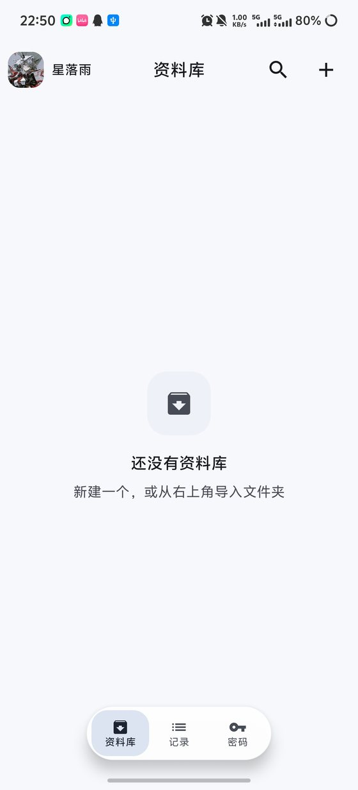
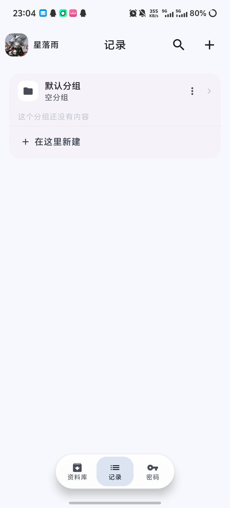
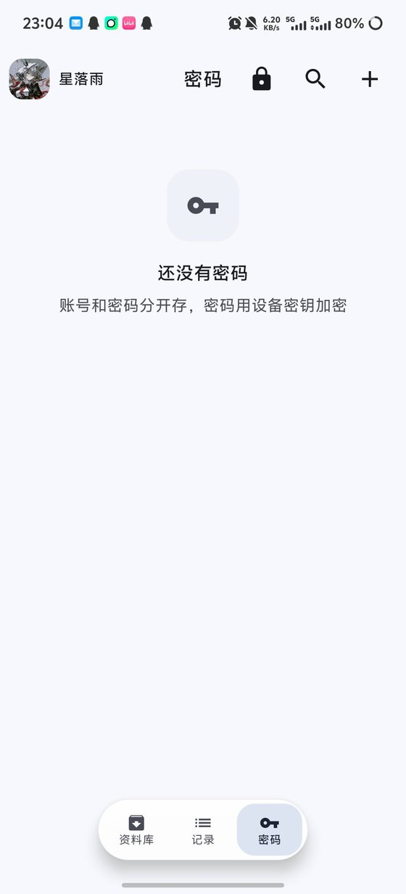
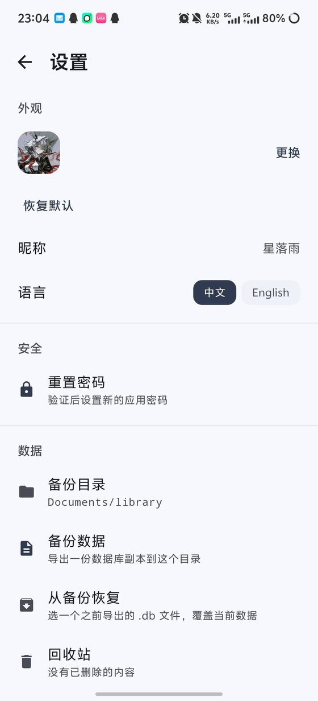

# 资料库 · Library

一个**完全不联网**的 Android 个人资料库：把散在手机里的文件、随手记的文字、各平台的登录密码收进同一个地方，离线可查。

> 没有账号、没有云同步、没有统计上报——`AndroidManifest.xml` 里连 `INTERNET` 权限都没申请。

[](LICENSE)


## 三个模块

| 模块 | 用途 |
|---|---|
| **资料库** | 把文件按层级归档、整理，便于查询。支持导入整个文件夹，保留原有的目录结构 |
| **记录** | 随手记待办、当前状态、心情、一段文字、对未来的规划 |
| **密码** | 存各平台的登录密码，同样便于查询 |

## 界面

| 资料库 | 记录 | 密码 | 设置 |
|---|---|---|---|
|  |  |  |  |

## 功能

**资料库**
- 导入文件夹 / 多个文件 / 单个文件，保留原有层级
- **只记录索引，不搬运文件**——导入的源文件仍然留在原来的位置
- 图片、视频、音频、PDF、文本的缩略图与预览
- 手动排序、按类型筛选、全文搜索

**记录**
- 纯文本 / 轻量 Markdown 书写，长文分段阅读
- 按分组归类，支持待办式的勾选内容

**密码**
- 按平台分组保存账号密码，一键复制
- 密码本体经 **AES-GCM** 加密后入库，密钥是随机生成的「数据密钥」：
  平时用 Android Keystore 把它包起来存本机，导出备份时再用你的口令包一层，所以备份换机解得开

**通用**
- 回收站：删除先留副本，可原样恢复回原目录
- 备份：导出**口令加密**的 `.libbak`（里面带着用口令包起来的数据密钥），换机也能把密码一起恢复
- 上锁：应用密码（PBKDF2-HMAC-SHA256，12 万轮，只存盐和派生值）或调用手机自带的指纹 / 锁屏密码
- 中文 / English 双语，首次启动有引导

## 两条设计底线

1. **不联网。** 应用没有任何网络权限，也没有一行联网代码。数据不外流，代价是没有云同步——备份和恢复都靠你自己选目录。
2. **导入不动源文件。** 应用保存的是文件的位置（SAF 授权），不是副本。所以照片还在相册里、视频还在下载文件夹里。反过来说，源文件被删掉或被移走，索引就会失效——这是这个设计必然的代价。

## 加密是怎么做的

- **密码字段**：AES-256-GCM，密钥是一段 32 字节随机「数据密钥」（DEK），AAD 固定 `secret-v2`
- **DEK 不落明文**：平时用 Android Keystore 里的密钥包一层存进 `crypto_keys`（AAD `dek-v1`）；
  导出备份时再用「备份口令」派生的密钥包一层，随容器一起走
- **版本只有一处真相**：`crypto_version` = 1 表示还是老的 Keystore 直加密文，2 表示已全量换成 DEK。
  读取路径只看这个值，密文前缀对不上就报错，不做「解不开换一种试试」
- **迁移是一次性的整表操作**：读旧行、改写、提交版本号在同一个 SQLite 事务里，任何一行失败整表回滚；
  Keystore 里的旧密钥一直保留，不删
- **DEK 丢了绝不重建**：换机、恢复出厂、密钥被系统作废时，`crypto_keys` 里那一行会解不开。
  这时只有「表里根本没有这一行」才允许生成新 DEK，有行一律报错并把用户引到备份恢复
  （写入口也只用 `INSERT`，不用 `INSERT OR REPLACE`，让主键约束兜底）；
  保存密码同样不再退回旧的 Keystore 直加密格式，只写 `v2:`
- **恢复顺序**：先用本机 Keystore 把备份里的 DEK 包好，成功后才动原库；覆盖前把原库整份留在 cacheDir，
  写新库或接管 DEK 失败就原地还原
- **容器解密**：不用 `CipherInputStream`（JDK 上它可能把 tag 校验失败吞成 -1），
  自己驱动 `update`/`doFinal`，再拿明文长度和密文长度对一次账
- **备份容器**：`LIBK1 | 版本 | PBKDF2 轮数 | salt(16) | iv(12) | AES-GCM 密文 + tag`，
  明文内容 = DEK + 数据库字节。口令不写进文件，也不等于锁屏口令

## 构建

需要 **JDK 25**（AGP 9.2.1 的工具链要求）和 **Android SDK 37**。

```bash
# debug 包，直接能装
./gradlew :app:assembleDebug

# release 包：需要签名信息
cp keystore.properties.example keystore.properties   # 然后填上自己的 keystore
./gradlew :app:assembleRelease
```

跑测试：

```bash
./gradlew :app:testDebugUnitTest
```

覆盖加解密往返、IV 不重复、AAD 不匹配即失败、容器错口令/篡改/截断、迁移整批全成或全不改写、密钥丢失时不重建也不覆盖旧记录等 29 个用例。

Windows 下也可以直接双击 `build.bat`（用的是系统里的 `JAVA_HOME` / `ANDROID_HOME`）。

`keystore.properties` 和 `keystore/` 已被 `.gitignore` 排除，自己的签名材料不会误传。

## 代码结构

```
app/src/main/java/com/library/app/
├── data/
│   ├── db/          Schema + SQLiteOpenHelper 手写迁移（当前 version 8）
│   ├── dao/         Entry / Folder / Module 的 SQL
│   ├── files/       FileStore、FolderImporter、TrashStore、BackupManager
│   ├── crypto/      CryptoBox（Keystore）、DataKey（数据密钥）、BackupCodec（加密备份容器）
│   ├── AppLock.kt   应用密码 / 手机凭证
│   └── Repository.kt  业务入口
├── ui/
│   ├── nav/         自研 Navigator + Route（没有用 Navigation 库）
│   ├── components/  顶栏、底部 tab、对话框、图标（全部是代码画的 VectorDrawable）
│   └── screens/     各页面 + ViewModel
└── i18n/            中英文案表
```

技术栈：Kotlin + Jetpack Compose (Material 3)，原生 `SQLiteOpenHelper` 手写迁移，零第三方网络 / 图片库依赖。全项目约 1.2 万行 Kotlin。

## 已知限制

- 只有 Android（minSdk 30），没有 iOS / 桌面版
- 没有云同步，多设备之间只能靠导出的 `.libbak` 手动搬（需要记住备份口令）
- 索引依赖系统给目录的持久授权，卸载重装后需要重新导入
- 忘记应用密码只能在验证手机凭证后重设；数据不会丢，但密码框本身没有「找回」通道
- 忘记**备份口令**这份备份就打不开了：口令不落盘，没有任何后门

## 协议

[GPL-3.0](LICENSE)

## 开发

本应用使用 deepseek-flash-1017 模型完成所有代码层面的开发。
